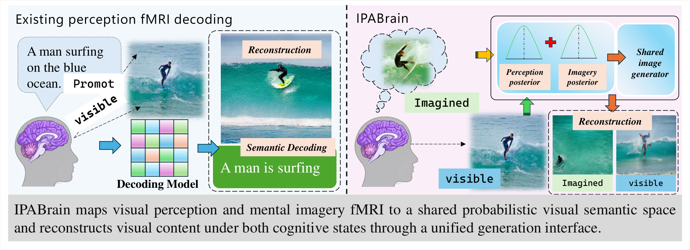
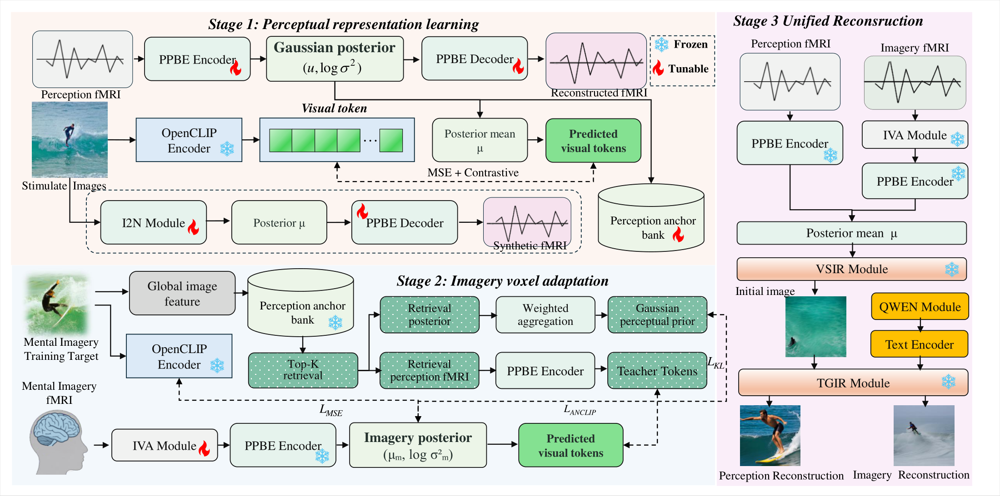

# IPABrain

IPABrain 从 fMRI 重建人看到的图像和在脑中形成的视觉意象。框架先用配对的感知 fMRI 和图像学习概率表征，再用感知语义锚点指导意象体素适配，使两种状态的脑响应能够通过共享的视觉通路生成图像。文本分支进一步预测语义条件，用于精修初始重建。



## 方法结构



图中展示了 IPABrain 的三个阶段：感知表征学习、意象体素适配和统一图像重建。

| 模块 | 作用 | 代码入口 |
| --- | --- | --- |
| **PPBE · 感知概率脑编码器** | 从感知 fMRI 估计高斯后验，学习与图像语义对齐的脑表征。 | [编码器](src/models/brainvae_ppbe.py) · [训练](scripts/train_brainvae_scheme1.py) |
| **IVA · 意象体素适配器** | 学习被试专属的仿射残差映射。训练时以图像特征监督后验均值，并为自然图像引入感知锚点约束。 | [适配器](src/models/imagery_residual_comparison.py) · [锚点聚合](src/utils/perception_anchor_prior.py) · [训练与推理](output_1104/scripts/run_multisubject_linear_imagery.py) |
| **VSIR · 视觉语义初始重建** | 将 PPBE 的后验均值映射为 OpenCLIP 视觉特征，再由冻结的 SDXL-UnCLIP 生成初始图像。 | [视觉映射](src/models/clip_mapping.py) · [训练](scripts/train_clip_mapping.py) · [初图重建](scripts/decode_clip_mapping.py) |
| **TGIR · 文本引导图像精修** | 从未经适配的 fMRI 提取 PPBE 后验均值，用三分支岭回归预测文本特征，再用 SDXL 精修初图。 | [岭回归训练](output_1104/scripts/ridge_multisubject_three_text.py) · [文本特征预测](output_1104/scripts/predict_multisubject_ridge.py) · [精修](output_1104/scripts/refine_multisubject_vision_imagery_three.py) |

## 运行步骤

### 1. 安装环境并配置数据路径

使用 Linux、Python 3.10 或以上版本，并安装与显卡和 CUDA 版本匹配的 PyTorch、torchvision 和 xFormers。以下命令在仓库根目录执行。

```bash
python -m pip install -r requirements.txt
```

在 [configs/paths.example.yaml](configs/paths.example.yaml) 中设置 NSD 和 NSD-Imagery 的路径。`raw_nsd_root` 指向包含 `nsddata/` 和 `nsddata_betas/` 的目录。预处理脚本的 `--annots` 接收按 NSD 图像编号索引的本地图像注释数组。

默认权重目录为 `huggingface/`。初图重建需要 OpenCLIP ViT-bigG/14 和 MindEye2 SDXL-UnCLIP 权重。文本精修还需要 `clip-vit-large/` 下的 CLIP-L 模型与分词器，以及 `zavychromaxl_v30.safetensors`。数据和权重由运行者在本地准备。

### 2. 准备 fMRI 和图像特征，训练 PPBE

下面以被试 02 为例。将 `NSD_ANNOTATIONS` 和 `NSD_SESSIONS` 设置为本地注释数组路径和该被试可用的 NSD 扫描会话数。

```bash
SUBJECT=2
NSD_SESSIONS=40
NSD_ANNOTATIONS=/path/to/nsd_image_annotations.npy
ENCODER_CONFIG=configs/brainvae_scheme1_ppbe.yaml

python scripts/prepare_nsd_perception_fmri.py \
  --subject "$SUBJECT" --sessions "$NSD_SESSIONS" --annots "$NSD_ANNOTATIONS"
python scripts/extract_nsd_sdxl_clip_vision.py --subject "$SUBJECT" --device cuda
python scripts/prepare_imagery_nsd.py --subject "$SUBJECT"
python scripts/extract_imagery_clip.py --subjects "$SUBJECT" --device cuda

python scripts/prepare_scheme1_data.py \
  --config "$ENCODER_CONFIG" --subject "$SUBJECT" --reuse
python scripts/train_brainvae_scheme1.py \
  --config "$ENCODER_CONFIG" --subject "$SUBJECT" --device cuda
```

预处理对齐 fMRI、刺激编号和视觉特征。PPBE 使用 NSD 感知训练集学习脑表征，并用内部验证集选择检查点。

### 3. 训练视觉映射并生成感知初图

设置 `BRAIN_CHECKPOINT` 为上一步选出的 PPBE 权重。第一条命令训练基础映射。对比微调使用另一份配置 `VISUAL_CONFIG`，将 `model.type` 设为 `adatoken_refinement`，用 `training.initialize_from` 指向基础映射检查点，将 `objective.type` 设为 `generation_contrastive`，并使用新的 `run_name`。微调后，将 `VISUAL_CHECKPOINT` 指向选出的视觉映射权重。

```bash
BRAIN_CHECKPOINT=/path/to/brain_encoder/best.pt

python scripts/train_clip_mapping.py \
  --config configs/clip_mapping_ppbe_local_adatoken.yaml \
  --subject "$SUBJECT" --brainvae-checkpoint "$BRAIN_CHECKPOINT" --device cuda

VISUAL_CONFIG=/path/to/visual_mapping.yaml
python scripts/train_clip_mapping.py \
  --config "$VISUAL_CONFIG" --subject "$SUBJECT" \
  --brainvae-checkpoint "$BRAIN_CHECKPOINT" --device cuda

VISUAL_CHECKPOINT=/path/to/visual_mapping/best.pt

python scripts/decode_clip_mapping.py \
  --config "$VISUAL_CONFIG" --checkpoint "$VISUAL_CHECKPOINT" \
  --brainvae-checkpoint "$BRAIN_CHECKPOINT" \
  --subject "$SUBJECT" --dataset nsd_test --device cuda
```

### 4. 训练 IVA，重建心理意象

意象运行入口读取与同一被试匹配的感知检查点、视觉映射配置、意象试次清单和训练记录。按对应被试的实验目录放置产物后，先运行预检。这一步需要已有的被试配置与校验记录。预检通过后，依次准备划分、检索感知锚点、提取教师特征和构建先验，再训练适配器及生成初图。

```bash
IMAGERY_RUNNER=output_1104/scripts/run_multisubject_linear_imagery.py

python "$IMAGERY_RUNNER" --subject "$SUBJECT" --stage preflight
for stage in prepare retrieval teachers prior; do
  python "$IMAGERY_RUNNER" --subject "$SUBJECT" --stage "$stage" --device cuda:0
done
for stage in train predict generate; do
  python "$IMAGERY_RUNNER" --subject "$SUBJECT" --stage "$stage" \
    --method mu_mse --device cuda:0
done
```

`mu_mse` 对应论文主方法。心理意象重建使用每个目标刺激的 4 条留出 fMRI 试次的平均响应，评估对象为已见刺激的留出试次。初图写入 `output_1104/multisubject_linear_imagery_v1/subjXX/mu_mse/initial/imagery/`。

### 5. 预测文本条件并精修

论文使用冻结的 **Qwen3.5-2B** 为 NSD 图像生成描述，再用 CLIP-L 和 OpenCLIP bigG 编码出两路文本序列及一路全局特征，作为训练三分支岭回归的监督。复现这一设置需要在训练前准备 Qwen 描述并将它们接入文本特征训练流程。

推理时，[文本预测脚本](output_1104/scripts/predict_multisubject_ridge.py) 读取未经 IVA 适配的 PPBE 后验均值。[精修脚本](output_1104/scripts/refine_multisubject_vision_imagery_three.py) 接收初图目录（`--source`）、预测文本特征目录（`--prediction`）、与初图对应的试次清单（`--mu-manifest`）和输出目录（`--output`）。被试 01 的岭回归训练使用 [ridge_three_text.py](output_1104/scripts/ridge_three_text.py)。

已有前序实验产物时，可以用[多被试队列](output_1104/scripts/queue_multisubject_linear_imagery.py) 串联适配、初图、精修与评估。队列依赖训练生成的被试配置、检查点、试次清单和校验记录，启动前用 `--stage preflight` 检查。

### 6. 评估重建图像

把 `--dataset-dir` 指向初图或精修结果的具体条件目录。该目录应含 `metadata.json` 和各次采样的 `sampleXX/manifest.json`。评估会按刺激配对目标图和重建图，对每次采样分别评分，再对各次采样取均值。结果保存在该目录的 `image_metrics.json`。

```bash
python scripts/eval_scheme1_reconstruction.py \
  --dataset-dir /path/to/reconstruction --device cuda \
  --models Alex2,Alex5,Incep,CLIP,Eff,SwAV \
  --clip-ckpt huggingface/ViT-L-14.pt \
  --swav-ckpt huggingface/swav_800ep_pretrain.pth.tar
```

八项指标包括 PixCorr、SSIM、AlexNet 第 2 层和第 5 层的二选一识别准确率、Inception 和 CLIP 二选一识别准确率，以及 EfficientNet-B1 和 SwAV 特征相关距离。只计算 PixCorr 和 SSIM 时，省略 `--models` 及两个评估权重参数即可，也可使用 `--device cpu`。
